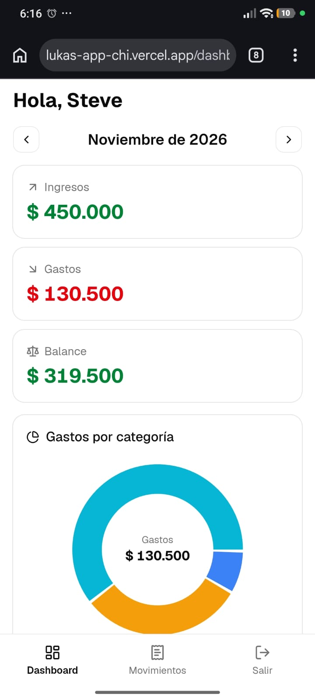
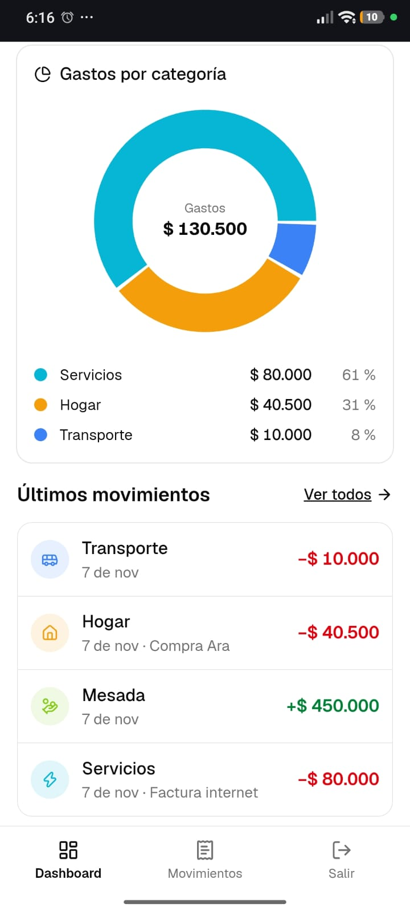
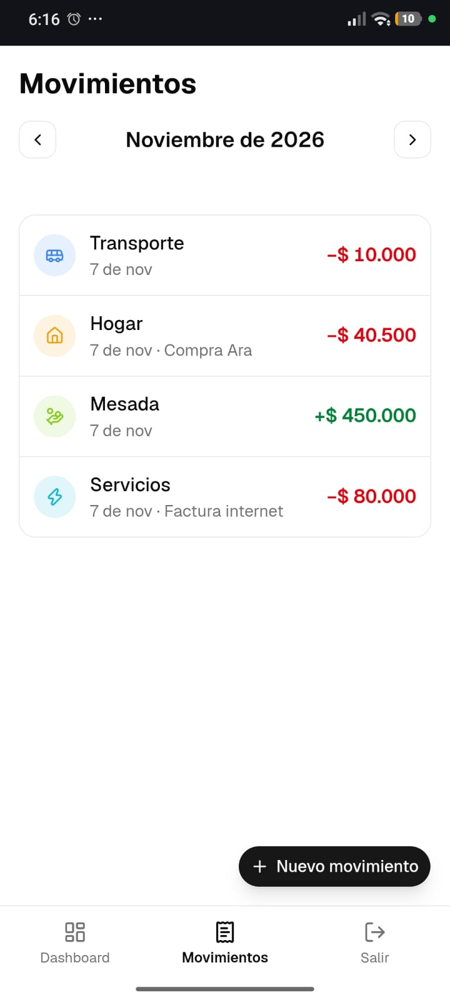
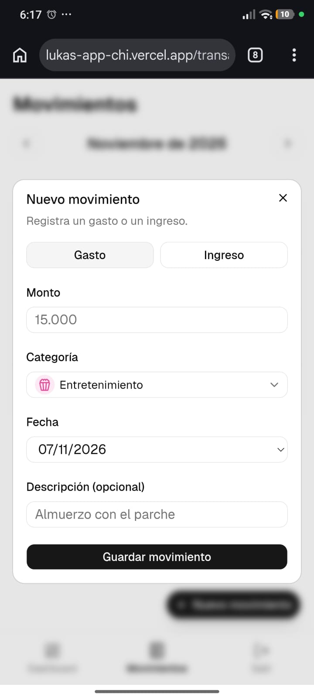
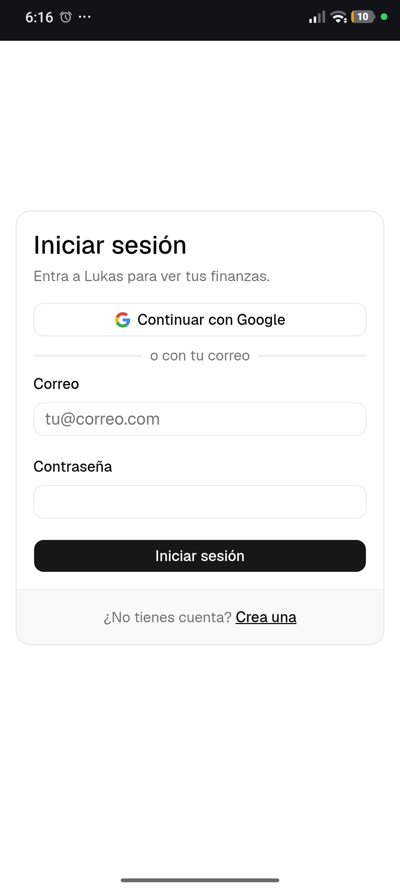

# Lukas

[](https://github.com/lsteveali/lukas-app/actions/workflows/ci.yml)

**Lukas** es una app web de finanzas personales para estudiantes y jóvenes en Colombia: registras tus gastos e ingresos en pesos y ves en qué se te van las lucas cada mes.

El nombre viene de _"lucas"_, la forma coloquial de decir "mil pesos".

👉 **App en producción:** [lukas-app-chi.vercel.app](https://lukas-app-chi.vercel.app)

## Capturas

<table>
  <tr>
    <td align="center"><br /><sub>Dashboard del mes</sub></td>
    <td align="center"><br /><sub>Gastos por categoría y últimos movimientos</sub></td>
    <td align="center"><br /><sub>Movimientos del mes</sub></td>
  </tr>
  <tr>
    <td align="center"><br /><sub>Nuevo movimiento</sub></td>
    <td align="center"><br /><sub>Inicio de sesión</sub></td>
    <td></td>
  </tr>
</table>

## Funcionalidades

**Disponibles hoy (v0.1)**

- **Cuenta:** registro e inicio de sesión con correo y contraseña (con confirmación por correo) o con Google.
- **Movimientos:** registra gastos e ingresos con monto, categoría, fecha y descripción; edítalos o elimínalos con confirmación.
- **Filtro por mes** en la URL (`/transacciones?mes=2026-11`): se puede compartir y recargar sin perder el mes.
- **Dashboard del mes:** ingresos, gastos y balance; dona de gastos por categoría con leyenda (monto y porcentaje); últimos 5 movimientos.
- **Categorías predeterminadas** con icono y color: Comida, Transporte, Universidad, Hogar, Servicios, Salud, Entretenimiento, Ropa y Otros (gastos); Salario, Mesada, Freelance y Otros (ingresos).
- **Pensada para el celular:** navegación inferior fija y formularios en diálogos.

## Roadmap

- **v0.2 · Metas y presupuestos:** metas de ahorro con barra de progreso y aportes; presupuesto mensual por categoría con alertas al 80 % y al 100 %; tests e2e con Playwright.
- **v0.3 · Gastos compartidos:** grupos (apartamento, salidas, viajes) con invitación por enlace o correo; gastos con división igual o personalizada; balances simplificados para minimizar transferencias; registro de pagos.
- **v0.4 · Extras:** escaneo de facturas con IA, PWA instalable, exportar a CSV y modo oscuro.

## Stack

| Tecnología | Por qué |
| --- | --- |
| **Next.js 16** (App Router) + **TypeScript** estricto | Server Components y Server Actions: los datos y las mutaciones viven en el servidor, y el tipado estricto atrapa errores antes de producción. |
| **Tailwind CSS 4** + **shadcn/ui** (Radix) | Estilos rápidos y consistentes, con componentes accesibles que viven en el repo y se pueden modificar. |
| **Supabase** (PostgreSQL + Auth) | Base de datos relacional con Row Level Security y autenticación (correo y Google) sin montar un backend propio. |
| **@supabase/ssr** | Clientes separados para navegador y servidor, con la sesión en cookies y refrescada en el `proxy` de Next. |
| **react-hook-form** + **zod** | Formularios fluidos en el cliente y **los mismos esquemas** para validar otra vez en el servidor. |
| **Recharts** | Gráficas declarativas en React; usada para la dona de gastos por categoría. |
| **Vitest** | Tests unitarios rápidos y compatibles con TypeScript, sin configuración extra. |
| **ESLint** + **Prettier** | Calidad y formato uniformes, revisados en cada PR. |
| **GitHub Actions** + **Vercel** | CI en cada PR y despliegue automático, con vista previa por rama. |

## Decisiones técnicas destacadas

- **Dinero como entero (`bigint`).** Todos los montos se guardan en pesos enteros y en TypeScript son `number` enteros; nunca `float` ni decimales. `formatCOP` y `parseCOP` ([`src/lib/utils/money.ts`](src/lib/utils/money.ts)) son las únicas puertas de entrada y salida: `parseCOP` rechaza entradas ambiguas como `"1.5"` o `"15,000"` en lugar de adivinar, y `formatCOP` lanza un error si le llega un decimal. Los totales del dashboard se calculan en el servidor con funciones puras y testeadas.
- **Row Level Security en todas las tablas**, activado desde la migración que las crea. Cada usuario solo ve y modifica sus filas, y las categorías del sistema son de solo lectura. Como con RLS un `update` o `delete` sobre una fila ajena no da error (solo afecta 0 filas), las Server Actions encadenan `.select()` y responden "No se encontró el movimiento" si no cambió nada. El `user_id` siempre sale de la sesión en el servidor, nunca del formulario.
- **Fechas en hora de Bogotá.** "Hoy", el mes actual y los filtros se calculan con la zona `America/Bogota` ([`src/lib/utils/dates.ts`](src/lib/utils/dates.ts)), no con la hora del servidor (UTC en Vercel), que después de las 7 p. m. ya marca el día siguiente. La columna `date` también tiene por defecto la fecha de Bogotá.
- **Confirmación de correo con `token_hash`.** El enlace de confirmación va a `/auth/confirm` y se valida con `verifyOtp`, así funciona aunque se abra en otro navegador o en la app de correo del celular (el flujo PKCE por defecto solo funciona en el navegador donde la persona se registró).
- **Rutas protegidas por defecto.** El `proxy` de Next 16 exige sesión en todo lo que no sea `/`, `/login`, `/registro` o `/auth/*`, y el parámetro `?next=` solo acepta rutas internas para evitar redirecciones abiertas.

## Cómo correrlo en local

### Requisitos

- **Node.js 24** o superior y **npm**.
- Un **proyecto de Supabase** (el plan gratuito sirve). No hace falta Docker: el desarrollo usa el proyecto remoto.
- La **CLI de Supabase** se usa con `npx supabase@3.0.0`, no hay que instalarla.

### 1. Clonar e instalar

```bash
git clone https://github.com/lsteveali/lukas-app.git
cd lukas-app
npm install
```

### 2. Variables de entorno

Copia `.env.example` a `.env.local` y completa los valores desde **Supabase → Project Settings → API Keys**:

```bash
cp .env.example .env.local
```

| Variable | Valor |
| --- | --- |
| `NEXT_PUBLIC_SUPABASE_URL` | URL del proyecto (`https://<ref>.supabase.co`) |
| `NEXT_PUBLIC_SUPABASE_PUBLISHABLE_KEY` | Publishable key (`sb_publishable_…`) o la anon key clásica |

`.env.local` está en `.gitignore`. La `service_role` key no se usa en esta app y nunca debe ir en el cliente.

### 3. Base de datos

```bash
npx supabase@3.0.0 login
npx supabase@3.0.0 link --project-ref <ref-de-tu-proyecto>
npm run db:push    # aplica las migraciones de supabase/migrations/
npm run db:types   # regenera src/types/database.ts
```

Las migraciones crean las tablas, las políticas RLS, el trigger que crea el perfil al registrarse y las categorías predeterminadas.

### 4. Autenticación (en el panel de Supabase)

1. **Authentication → Sign In / Providers → Email:** activa _Confirm email_.
2. **Authentication → URL Configuration:** pon la Site URL y agrega a Redirect URLs `http://localhost:3000/**` (y tu dominio de producción con `/**`).
3. **Authentication → Emails → Confirm signup:** cambia el enlace de la plantilla por
   `{{ .RedirectTo }}?token_hash={{ .TokenHash }}&type=email`
4. **Google (opcional):** activa el proveedor con tu Client ID y Secret de Google Cloud.

### 5. Comandos

```bash
npm run dev            # servidor de desarrollo en http://localhost:3000
npm run build          # build de producción
npm run lint           # ESLint
npm run typecheck      # genera los tipos de rutas y corre tsc --noEmit
npm run test           # Vitest
npm run format         # Prettier (escribe)
npm run format:check   # Prettier (solo revisa, como en CI)
npm run db:push        # aplica migraciones pendientes al proyecto vinculado
npm run db:types       # regenera los tipos de la base de datos
```

## Flujo de trabajo

- **GitHub Flow:** `main` siempre está desplegable y nada se sube directo a ella. Cada issue tiene su rama (`feat/<n>-…`, `fix/…`, `chore/…`, `docs/…`, `ci/…`) y se integra con un Pull Request que la cierra (`Closes #n`).
- **Commits convencionales** en inglés y pequeños, uno por cambio lógico: `feat:`, `fix:`, `chore:`, `docs:`, `test:`, `refactor:`, `ci:`.
- **CI en cada PR** (y en `main`): lint, typecheck, tests, formato y build. Vercel publica una vista previa por rama y despliega `main` a producción.
- **El esquema solo cambia con migraciones** en `supabase/migrations/`, y los datos que deben existir en producción también van en migraciones (no en `seed.sql`).

El código va en inglés y la interfaz en español de Colombia. Las convenciones completas del proyecto están en [`CLAUDE.md`](CLAUDE.md).

## Licencia

[MIT](LICENSE) © 2026 ALICODE
